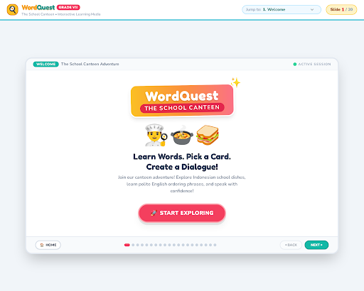

# 🍔 WordQuest — The School Canteen

<p align="center">
  
</p>

<h3 align="center">Learn Words. Pick a Card. Create a Dialogue!</h3>

<p align="center">
  An interactive English learning experience through a fun school canteen adventure.
</p>

<p align="center">
  
  
  
  
</p>

---

## 📖 About the Project

**WordQuest: The School Canteen** is an interactive English learning website designed to help seventh-grade students practice English in a familiar and engaging setting: the school canteen.

Through vocabulary exploration, interactive activities, quizzes, and dialogue practice, students can learn useful English expressions for ordering food and drinks, asking questions, and communicating politely.

The project combines educational content with a colorful, student-friendly interface to make English learning more enjoyable.

## ✨ Features

- **🍱 Food Vocabulary** — Explore common Indonesian school canteen dishes and their English names.
- **🥤 Drink Vocabulary** — Learn vocabulary related to drinks and ordering beverages.
- **💬 Useful Expressions** — Practice polite English phrases for everyday conversations.
- **🧩 Interactive Quizzes** — Test your understanding through questions and learning challenges.
- **🎴 Mystery Challenge** — Explore challenge activities designed to reinforce learning.
- **🗣️ Dialogue Practice** — Build confidence in creating conversations in a school canteen.
- **📚 Guided Learning Journey** — Navigate through 20 learning slides, from the welcome screen to the final mission.
- **🎨 Student-Friendly Interface** — Enjoy colorful illustrations, clear navigation, and an engaging learning layout.

## 🛠️ Built With

| Technology | Purpose |
|---|---|
| HTML5 | Structures the learning experience |
| Tailwind CSS | Styles the interface and layout |
| JavaScript | Powers interactive learning activities |
| Google Fonts | Enhances readability and visual identity |

## 🚀 Getting Started

You can run WordQuest locally without installing a framework or package manager.

### 1. Clone the repository

```bash
git clone git@github.com:Sakiih/word_quest_mini_game.git
```

Alternatively, use the HTTPS URL:

```bash
git clone https://github.com/Sakiih/word_quest_mini_game.git
```

### 2. Open the project

```bash
cd word_quest_mini_game
```

### 3. Run the website

Open `index.html` in your browser, or use the **Live Server** extension in Visual Studio Code.

> **Note:** An internet connection may be required to load external resources such as Tailwind CSS and Google Fonts.

## 📂 Project Structure

```text
word_quest_mini_game/
├── assets/
│   └── screenshot.png
├── index.html
├── README.md
└── LICENSE
```

## 🎯 Learning Objectives

By completing the activities in WordQuest, students can work toward:

- Recognizing common food and drink vocabulary.
- Understanding useful expressions when buying food and drinks.
- Practicing polite requests and responses in English.
- Constructing simple dialogues in a familiar everyday context.
- Building confidence through interactive learning activities.

## 👩‍🎓 Target Audience

- Grade VII students (junior high school).
- English language learners at the beginner level.
- Teachers looking for interactive materials for classroom activities.

## 🌐 Live Demo

**Coming soon!** A live website link will be added after deployment.

## 📄 License

This project is distributed under the license included in the repository. Please review the [`LICENSE`](LICENSE) file for details.

---

<p align="center">
  Made with ❤️ for fun and interactive English learning.
</p>

<p align="center">
  <b>WordQuest — Every word is a new adventure!</b>
</p>
